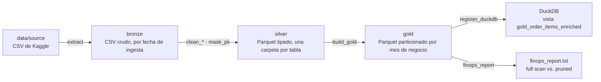
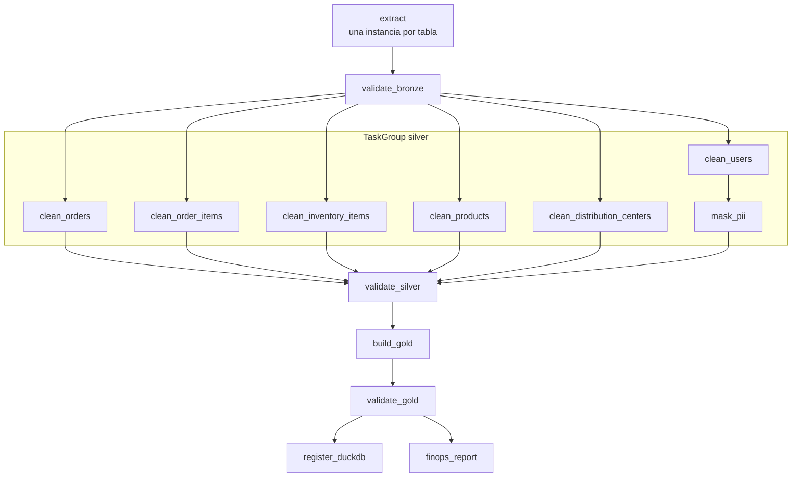
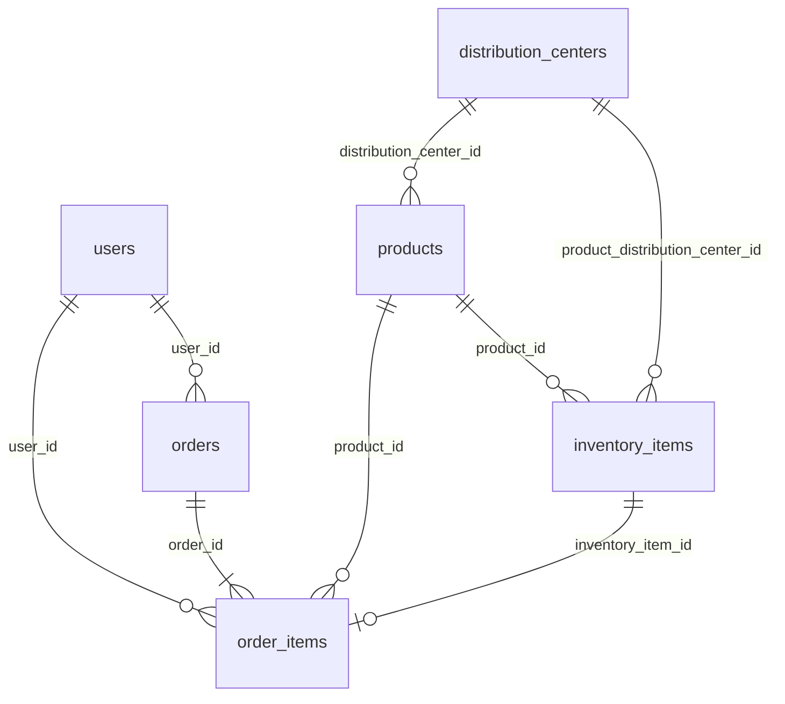

# Arquitectura del pipeline

Pipeline medallion local sobre el dataset TheLook eCommerce: Airflow orquesta tres capas en el disco (bronze, silver y gold) y DuckDB consulta gold. Todo corre en Docker, en una sola máquina. Las decisiones de calidad de datos, PII y modelado están justificadas en detalle en el [README](../README.md); este documento describe cómo encajan las piezas.

## Vista general



Cada flecha es una o más tareas del DAG `medallion_pipeline_dag`. Entre capa y capa hay una tarea de validación que corta la corrida si los datos no cumplen las reglas.

## Entorno

Airflow 3.1 corre con `docker compose` a partir del `docker-compose.yaml` oficial, con dos cambios: una imagen propia y un volumen para los datos.

## Almacenamiento

```
data/
├── source/                                   CSV originales de Kaggle (no se versionan)
├── bronze/{tabla}/ingested_year=YYYY/ingested_month=MM/{tabla}.csv
├── staging/users/users.parquet               temporal: users limpio con PII, lo borra mask_pii
├── silver/{tabla}/{tabla}.parquet
├── gold/order_items_enriched/year=YYYY/month=MM/order_items_enriched.parquet
├── catalog.duckdb                            vista de DuckDB sobre gold
└── finops_report.txt                         reporte de finops_report
```

| Capa | Formato | Partición | Qué guarda |
|---|---|---|---|
| Bronze | CSV, copia byte a byte del origen | Fecha de ingesta (`ingested_year`, `ingested_month`) | Una foto completa de cada archivo fuente por corrida. |
| Staging | Parquet | — | Solo `users` limpio y todavía con PII. Vive entre `clean_users` y `mask_pii`. |
| Silver | Parquet | Ninguna: la tabla completa | Datos tipados, normalizados, deduplicados y sin PII en claro. |
| Gold | Parquet | Fecha de negocio (`year`, `month` de `orders.created_at`) | El modelo analítico `order_items_enriched`. |

`year` y `month` no se escriben dentro de los Parquet de gold: están solo en el nombre de la carpeta, y DuckDB los lee como columnas con `hive_partitioning`.

## El DAG

`medallion_pipeline_dag` corre `@monthly` desde `start_date = 2019-01-01`, con `catchup=False`: los meses pasados se cargan con un backfill. Cada tarea se reintenta 2 veces con 15 s de espera, salvo las validaciones, y `max_active_tasks=4` limita cuántas corren a la vez.



| Tarea | Capa | Qué hace |
|---|---|---|
| `extract` | Bronze | Copia cada CSV de `data/source` a su carpeta de ingesta. Es una sola función mapeada sobre `SOURCE_FILES` con `.expand()`, así que las tablas se copian en paralelo. |
| `validate_bronze` | Bronze | Verifica que estén todas las tablas y que cada archivo tenga encabezado y al menos una fila. Sin reintentos. |
| `clean_orders`, `clean_order_items`, `clean_inventory_items`, `clean_products`, `clean_distribution_centers` | Silver | Leen el CSV como texto, descartan filas sin claves, deduplican por clave primaria, tipan y normalizan, y escriben el Parquet. Corren en paralelo. |
| `clean_users` → `mask_pii` | Staging → Silver | `clean_users` limpia `users` y lo deja en `staging/`. `mask_pii` hashea el email con SHA-256 + salt, borra los identificadores directos, publica en silver y borra el staging. |
| `validate_silver` | Silver | Corta la corrida si una clave primaria está repetida y reporta los huérfanos de cada clave foránea. Sin reintentos. |
| `build_gold` | Gold | Une las tablas de silver para las órdenes del mes de la corrida y sobrescribe esa partición. |
| `validate_gold` | Gold | Verifica grano único, ventana, nulos en claves y ausencia de PII, y loguea una huella SHA-256 del contenido. Sin reintentos. |
| `register_duckdb` | Catálogo | Crea o reemplaza la vista `gold_order_items_enriched` en `catalog.duckdb`. |
| `finops_report` | Catálogo | Compara la misma consulta con y sin filtro de partición y falla si el filtro no reduce los archivos leídos. |

Entre tareas viajan solo rutas por XCom, nunca DataFrames. Las validaciones no se reintentan porque reintentar no arregla datos malos.

## Modelo de datos

El modelo tiene 6 tablas fuente con 8 relaciones. `order_items` es la tabla central: tiene 4 claves foráneas y define el grano de gold.



`events.csv` (navegación del sitio) cuelga solo de `users` y no alimenta gold, por lo que quedó fuera del modelo para respetar el tamaño máximo de la consigna. Todavía figura en `SOURCE_FILES`, así que `extract` la sigue copiando a bronze aunque ninguna tarea de silver la lea.

**Gold: `order_items_enriched`.** Una fila por ítem vendido, con 30 columnas. Se arma así:

- `order_items` contra `orders` con `INNER JOIN`: un ítem sin orden no es una venta.
- Contra `users` (con `email_hash`, sin PII), `products` y `distribution_centers` con `LEFT JOIN`: un dato faltante de catálogo no puede borrar una venta.
- `inventory_items` no entra en el join: su costo coincide con el de `products` en todas las filas.
- Suma tres métricas derivadas: `margin`, `is_returned` y `delivery_days`.

## Gobernanza de PII

`users` es la única tabla con datos personales y nunca llega en claro a silver:

1. `clean_users` normaliza el email (minúsculas, sin espacios) y escribe en `staging/`.
2. `mask_pii` lee el salt de la Airflow Variable `PII_SALT` dentro de la tarea, calcula `email_hash` con SHA-256, borra nombre, apellido, email, dirección, código postal y coordenadas, y publica en silver.
3. `mask_pii` borra el staging. `validate_gold` vuelve a verificar que ninguna columna de PII haya llegado a gold.

## Catálogo y FinOps

`register_duckdb` crea una vista sobre `gold/order_items_enriched/**/*.parquet`. La vista no copia datos: guarda la consulta, así que cada partición nueva aparece sola. La ruta guardada es la del contenedor, por eso el catálogo se consulta desde Airflow. Desde Windows se consulta gold directo con `sql/gold_queries.sql`.

La validación FinOps existe en dos lugares con la misma lógica:

- **En el pipeline:** la tarea `finops_report` mide en cada corrida y escribe `data/finops_report.txt`.
- **En local:** `scripts/finops_validation.py` hace la misma medición desde la terminal y guarda el reporte en `docs/finops_report.txt`, que queda versionado con la entrega.

## Repositorio

```
├── dags/medallion_pipeline_dag.py    el DAG completo
├── scripts/
│   ├── finops_validation.py          validación FinOps desde la terminal
│   └── orders_eda.py                 exploración inicial de orders
├── sql/
│   ├── gold_queries.sql              consultas de register_duckdb
│   └── finops_queries.sql            consultas de finops_report y del script
├── docs/
│   ├── architecture.md               este documento
│   ├── finops_report.txt             último reporte FinOps generado en local
│   └── TP DE 2026 - Local.pdf        consigna
├── README.md                         decisiones de calidad de datos, PII y modelado
└── requirements.txt                  dependencias que se agregan a la imagen de Airflow
```

Los datos (`data/`) no se versionan: el repositorio guarda solo el código que los genera.
